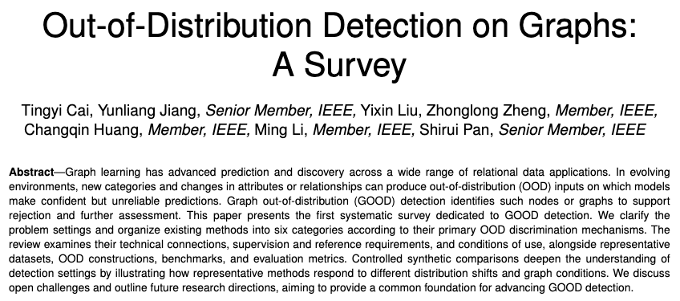

# Graph Out-of-Distribution (GOOD) Detection

This repository provides a comprehensive catalogue of research on **out-of-distribution (OOD) detection for graph-structured data**, i.e., *GOOD Detection (update: 20/11/2026)*.

The paper v1 (2025) is available on arXiv: [Out-of-Distribution Detection on Graphs: A Survey](https://arxiv.org/pdf/2502.08105).




**Catalogue snapshot:** November 2026 · **63 core detection methods** · **5 related references**.

The paper v2 (2026) is coming soon.


## Version note⭐
This repository catalogue has been expanded and reclassified for an ongoing survey revision. The linked 2025 arXiv manuscript reflects the earlier taxonomy; it has **not yet** been updated to match this README. The six families and their subcategories follow the revised survey taxonomy. Class assignments reflect each method's principal OOD-specific contribution, rather than mutually exclusive sets of techniques; a method may use components associated with other families.

---

## Core GOOD detection methods

**Taxonomy overview:** Representation Shaping (22), IND Distribution Modeling (4), Predictive Evidence Modeling (8), Relational Evidence Modeling (11), IND–OOD Boundary Learning (15), and Detection Calibration (3). IND Distribution Modeling has no subcategories in the revised taxonomy.

**Table conventions:** “Node” and “Graph” denote the detection target; **Node + Graph** means both are reported. The “Paper” link is omitted when the source table does not contain a verified URL. A missing link does not imply the paper is unavailable. 

### Representation Shaping (22)

| # | Method | Subcategory | Title | Year | Venue | Level | Paper |
|---:|---|---|---|---:|---|---|---|
| 1 | GOOD-D | Multi-view Representation Learning | GOOD-D: On Unsupervised Graph Out-Of-Distribution Detection | 2023 | WSDM | Graph | [Paper](https://dl.acm.org/doi/10.1145/3539597.3570446) |
| 2 | SEGO | Multi-view Representation Learning | Structural Entropy Guided Unsupervised Graph Out-Of-Distribution Detection | 2025 | AAAI | Graph | [Paper](https://ojs.aaai.org/index.php/AAAI/article/view/33897) |
| 3 | SGOOD | Multi-view Representation Learning | SGOOD: Substructure-enhanced Graph-Level Out-of-Distribution Detection | 2024 | CIKM | Graph | [Paper](https://dl.acm.org/doi/10.1145/3627673.3679710) |
| 4 | KEGOD | Multi-view Representation Learning | KEGOD: Kernel-enhanced Latent Substructure Learning for Graph Out-Of-Distribution Detection | 2026 | WWW | Graph | [Paper](https://doi.org/10.1145/3774904.3792465) |
| 5 | CLINIC | Multi-view Representation Learning | CLINIC: Towards High-quality Graph Out-Of-Distribution Detection | 2026 | ICML | Graph | [Paper](https://proceedings.mlr.press/v306/wang26kt.html) |
| 6 | HGOOD | Multi-view Representation Learning | HGOOD: Hypergraph-enhanced Graph Contrastive Learning for Graph Out-of-Distribution Detection | 2026 | IJCAI | Graph | [Paper](https://www.ijcai.org/proceedings/2026/285) |
| 7 | UniGOOD | Multi-view Representation Learning | Unifying Graph Out-of-Distribution Generalization and Detection through Spectral Contrastive Invariant Learning | 2026 | WWW | Graph | [Paper](https://doi.org/10.1145/3774904.3792586) |
| 8 | TNT-OOD | Multi-view Representation Learning | Text Meets Topology: Rethinking Out-of-distribution Detection in Text-Rich Networks | 2025 | EMNLP | Node | [Paper](https://aclanthology.org/2025.emnlp-main.280/) |
| 9 | GOODAT | Information Bottleneck | GOODAT: Towards Test-time Graph Out-of-Distribution Detection | 2024 | AAAI | Graph | [Paper](https://ojs.aaai.org/index.php/AAAI/article/view/29480) |
| 10 | RedOUT | Information Bottleneck | Redundancy-Aware Test-Time Graph Out-of-Distribution Detection | 2025 | NeurIPS | Graph | [Paper](https://papers.nips.cc/paper_files/paper/2025/hash/adc8f8b701b008611b196e00b8e81dab-Abstract-Conference.html) |
| 11 | TIDE | Information Bottleneck | What Information Matters? Graph Out-of-Distribution Detection via Tri-Component Information Decomposition | 2026 | ICML | Node | [Paper](https://proceedings.mlr.press/v306/wang26gl.html) |
| 12 | AAGOD | Graph Prompting | A Data-centric Framework to Endow Graph Neural Networks with Out-Of-Distribution Detection Ability | 2023 | KDD | Graph | [Paper](http://shichuan.org/doc/150.pdf) |
| 13 | DGP | Graph Prompting | Disentangled Graph Prompting for Out-Of-Distribution Detection | 2026 | IEEE TKDE | Graph | [Paper](https://doi.org/10.1109/TKDE.2026.3678022) |
| 14 | IBPL | Graph Prompting | IBPL: Information Bottleneck-based Prompt Learning for Graph Out-of-Distribution Detection | 2025 | Neural Networks | Graph | [Paper](https://www.sciencedirect.com/science/article/pii/S0893608025002606) |
| 15 | SIGOOD | Graph Prompting | From Subtle to Significant: Prompt-Driven Self-Improving Optimization in Test-Time Graph OOD Detection | 2026 | AAAI | Graph | [Paper](https://ojs.aaai.org/index.php/AAAI/article/view/38617) |
| 16 | APEKG | Graph Prompting | Adaptive Prompt and External Knowledge Guidance for Enhancing Molecular Graph OOD Detection | 2026 | Knowledge-Based Systems | Graph | [Paper](https://doi.org/10.1016/j.knosys.2026.116313) |
| 17 | UGNN | Embedding Geometry | Towards Semi-Supervised Universal Graph Classification | 2023 | IEEE TKDE | Graph | [Paper](https://arxiv.org/abs/2305.19598) |
| 18 | GPN-CE-GD | Embedding Geometry | Improvements on Uncertainty Quantification for Node Classification via Distance-Based Regularization | 2023 | NeurIPS | Node | [Paper](https://proceedings.neurips.cc/paper_files/paper/2023/hash/ad84864002a72c344c2227d7eb8842b1-Abstract-Conference.html) |
| 19 | HGOOD-D | Embedding Geometry | HGOOD-D: Hyperbolic Hierarchical Exploration for Graph Out-of-Distribution Detection | 2026 | IEEE TKDE | Graph | [Paper](https://doi.org/10.1109/TKDE.2026.3690579) |
| 20 | UniGOD | Embedding Geometry | Breaking One-Size-Fits-All: Revisiting Out-of-Distribution Detection on Graphs Under Diverse Distribution Shifts | 2026 | AAAI | Node | [Paper](https://ojs.aaai.org/index.php/AAAI/article/view/39748) |
| 21 | Feature norm regularization | Embedding Geometry | Feature norm-based regularization for robust out-of-distribution detection in graph neural networks | 2026 | Neurocomputing | Node (graph-level unverified) | [Paper](https://doi.org/10.1016/j.neucom.2026.134743) |
| 22 | OSSC | Temporal Representation Learning | A Dynamic Variational Framework for Open-World Node Classification in Structured Sequences | 2022 | ICDM | Node | [Paper](https://shiruipan.github.io/publication/icdm-22-zhang/icdm-22-zhang.pdf) |

### IND Distribution Modeling (4)

| # | Method | Title | Year | Venue | Level | Paper |
|---:|---|---|---:|---|---|---|
| 23 | GraphDE | GraphDE: A Generative Framework for Debiased Learning and Out-of-Distribution Detection on Graphs | 2022 | NeurIPS | Graph | [Paper](https://proceedings.neurips.cc/paper_files/paper/2022/hash/c34262c35aa5f8c1a091822cbb2020c2-Abstract-Conference.html) |
| 24 | GPN | Graph Posterior Network: Bayesian Predictive Uncertainty for Node Classification | 2021 | NeurIPS | Node | [Paper](https://proceedings.neurips.cc/paper_files/paper/2021/hash/95b431e51fc53692913da5263c214162-Abstract.html) |
| 25 | EnergyDef | An Energy-centric Framework for Category-free Out-of-distribution Node Detection in Graphs | 2024 | KDD | Node | [Paper](https://dl.acm.org/doi/10.1145/3637528.3671939) |
| 26 | DeGEM | Decoupled Graph Energy-based Model for Node Out-of-Distribution Detection on Heterophilic Graphs | 2025 | ICLR | Node | [Paper](https://proceedings.iclr.cc/paper_files/paper/2025/hash/c247c31884eda37a48330b9df5adb174-Abstract-Conference.html) |

### Predictive Evidence Modeling (8)

| # | Method | Subcategory | Title | Year | Venue | Level | Paper |
|---:|---|---|---|---:|---|---|---|
| 27 | GKDE | Uncertainty Estimation | Uncertainty Aware Semi-Supervised Learning on Graph Data | 2020 | NeurIPS | Node | [Paper](https://proceedings.neurips.cc/paper/2020/hash/968c9b4f09cbb7d7925f38aea3484111-Abstract.html) |
| 28 | S-BGCN-T-K | Uncertainty Estimation | Uncertainty-Aware Graph-Based Multimodal Remote Sensing Detection of Out-Of-Distribution Samples | 2021 | CIKM Workshops | Node | [Paper](https://ceur-ws.org/Vol-3052/short5.pdf) |
| 29 | OpenWGL | Uncertainty Estimation | OpenWGL: Open-World Graph Learning | 2020 | ICDM | Node | [Paper](https://ieeexplore.ieee.org/document/9338284) |
| 30 | ML-EGNNs | Uncertainty Estimation | Evidence-Based Out-of-Distribution Detection on Multi-Label Graphs | 2025 | SDM | Node | [Paper](https://epubs.siam.org/doi/10.1137/1.9781611978520.63) |
| 31 | NODESAFE | Energy Scores | Bounded and Uniform Energy-based Out-of-distribution Detection for Graphs | 2024 | ICML | Node | [Paper](https://openreview.net/forum?id=mjh7AOWozN) |
| 32 | ML-GOOD | Energy Scores | ML-GOOD: Towards Multi-Label Graph Out-of-Distribution Detection | 2025 | AAAI | Node | [Paper](https://ojs.aaai.org/index.php/AAAI/article/view/33718) |
| 33 | GeoEnergy | Energy Scores | Geometric Logit Decoupling for Energy-Based Graph Out-of-distribution Detection | 2025 | NeurIPS | Node | [Paper](https://papers.nips.cc/paper_files/paper/2025/hash/8bd9f3ae50e9e1230e483dda4873e710-Abstract-Conference.html) |
| 34 | GLIP-OOD | Semantic Matching | GLIP-OOD: Zero-Shot Graph OOD Detection with Foundation Model | 2025 | arXiv:2504.21186 | Node | [Paper](https://arxiv.org/abs/2504.21186) |

### Relational Evidence Modeling (11)

| # | Method | Subcategory | Title | Year | Venue | Level | Paper |
|---:|---|---|---|---:|---|---|---|
| 35 | LMN | OOD-aware Message Passing | End-to-end open-set semi-supervised node classification with out-of-distribution detection | 2022 | IJCAI | Node | [Paper](https://github.com/ca1man-2022/Awesome-GOOD-Detection) |
| 36 | OODGAT | OOD-aware Message Passing | Learning on Graphs with Out-of-Distribution Nodes | 2022 | KDD | Node | [Paper](https://dl.acm.org/doi/10.1145/3534678.3539457) |
| 37 | GNNSafe | Propagation-based Detection | Energy-based out-of-distribution detection for graph neural networks | 2023 | ICLR | Node | [Paper](https://arxiv.org/abs/2302.02914) |
| 38 | GRASP | Propagation-based Detection | Revisiting Score Propagation in Graph Out-of-Distribution Detection | 2024 | NeurIPS | Node | [Paper](https://openreview.net/forum?id=jb5qN3212b) |
| 39 | EDBD | Propagation-based Detection | Spreading Out-of-Distribution Detection on Graphs | 2025 | ICLR | Node | [Paper](https://openreview.net/forum?id=p1TBYyqy8v) |
| 40 | EPGNN | Propagation-based Detection | Graph OOD Detection via Plug-and-Play Energy-based Evaluation and Propagation | 2025 | IJCAI | Node | [Paper](https://www.ijcai.org/proceedings/2025/786) |
| 41 | OODHG | Propagation-based Detection | Out-of-distribution Detection in Heterogeneous Graphs via Energy Propagation | 2025 | Knowledge-Based Systems | Node | [Paper](https://www.sciencedirect.com/science/article/abs/pii/S0950705125007130) |
| 42 | GNSD | Propagation-based Detection | Graph Neural Stochastic Diffusion for Estimating Uncertainty in Node Classification | 2024 | ICML | Node | [Paper](https://proceedings.mlr.press/v235/lin24x.html) |
| 43 | TopoOOD | Neighborhood Discrepancy | Graph Out-of-Distribution Detection Goes Neighborhood Shaping | 2024 | ICML | Node | [Paper](https://openreview.net/forum?id=pmcusTywXO) |
| 44 | RAGNOR | Neighborhood Discrepancy | Refining Norms: A Post-hoc Framework for OOD Detection in Graph Neural Networks | 2025 | NeurIPS | Node / Graph | [Paper](https://papers.nips.cc/paper_files/paper/2025/hash/39fac857b4467e3ef4f358186bb07d81-Abstract-Conference.html) |
| 45 | SpecGap | Spectral Filtering | SpectralGap: Graph-Level Out-of-Distribution Detection via Laplacian Eigenvalue Gaps | 2025 | IJCAI | Graph | [Paper](https://www.ijcai.org/proceedings/2025/584) |

### IND–OOD Boundary Learning (15)

| # | Method | Subcategory | Title | Year | Venue | Level | Paper |
|---:|---|---|---|---:|---|---|---|
| 46 | HGOE | Outlier Exposure | HGOE: Hybrid External and Internal Graph Outlier Exposure for Graph Out-of-Distribution Detection | 2024 | ACM MM | Graph | [Paper](https://dl.acm.org/doi/10.1145/3664647.3681118) |
| 47 | Open-WRF | Weakly Supervised Detection | Open-World Lifelong Graph Learning | 2023 | IJCNN | Node | [Paper](https://arxiv.org/abs/2310.12565) |
| 48 | Wang et al. | Weakly Supervised Detection | Hyperspectral Anomaly Detection via Graph Out-of-Distribution Detection | 2026 | IEEE JSTARS | Node (pixel-wise) | [Paper](https://doi.org/10.1109/JSTARS.2026.3670599) |
| 49 | LLM-GOOD | Weakly Supervised Detection | Few-Shot Graph Out-of-Distribution Detection with LLMs | 2025 | ECML PKDD | Node | [Paper](https://mlanthology.org/ecmlpkdd/2025/xu2025ecmlpkdd-fewshot/) |
| 50 | CFC | Weakly Supervised Detection | Coarse-to-Fine Open-Set Graph Node Classification with Large Language Models | 2026 | AAAI | Node | [Paper](https://ojs.aaai.org/index.php/AAAI/article/view/40996) |
| 51 | GOLD | Synthetic Outlier Generation | Graph Out-of-Distribution Detection via Implicit Adversarial Latent Generation | 2025 | ICLR | Node | [Paper](https://openreview.net/forum?id=y5einmJ0Yx) |
| 52 | SynCo-OOD | Synthetic Outlier Generation | SynCo-OOD: Synthetic-contrastive Learning for Graph Out-of-distribution Detection | 2026 | Neurocomputing | Node | [Paper](https://www.sciencedirect.com/science/article/pii/S092523122503019X) |
| 53 | NOAOM | Synthetic Outlier Generation | NOAOM: Near-Out-Of-Distribution Awareness Optimization Module for Robust Graph OOD Detection | 2026 | Knowledge-Based Systems | Graph | [Paper](https://www.sciencedirect.com/science/article/abs/pii/S0950705126010415) |
| 54 | PGR-MOOD | Synthetic Outlier Generation | Optimizing OOD Detection in Molecular Graphs: A Novel Approach with Diffusion Models | 2024 | KDD | Graph | [Paper](https://arxiv.org/abs/2404.15625) |
| 55 | PGOS | Synthetic Outlier Generation | Learning to Explore: Policy-Guided Outlier Synthesis for Graph Out-of-Distribution Detection | 2026 | AAAI | Graph | [Paper](https://ojs.aaai.org/index.php/AAAI/article/view/39768) |
| 56 | GDDA | Synthetic Outlier Generation | GDDA: Semantic OOD Detection on Graphs under Covariate Shift via Score-Based Diffusion Models | 2025 | ICASSP | Graph | [Paper](https://doi.org/10.1109/ICASSP49660.2025.10890879) |
| 57 | SA-Diff | Synthetic Outlier Generation | SA-Diff: Semantic-Aware Graph Outlier Generation via Diffusion Models for Graph Out-of-Distribution Detection | 2026 | Knowledge-Based Systems | Graph | [Paper](https://www.sciencedirect.com/science/article/pii/S0950705126002364) |
| 58 | LLMGuard | Synthetic Outlier Generation | Out-of-Distribution Detection via LLM-Guided Outlier Generation for Text-attributed Graph | 2025 | Findings of ACL | Node | [Paper](https://aclanthology.org/2025.findings-acl.1001/) |
| 59 | LECT | Synthetic Outlier Generation | LLM-Enhanced Energy Contrastive Learning for Out-of-Distribution Detection in Text-Attributed Graphs | 2026 | AAAI | Node | [Paper](https://ojs.aaai.org/index.php/AAAI/article/view/39611) |
| 60 | SMUG | Meta-learning | SMUG: Sand Mixing for Unobserved Class Detection in Graph Few-Shot Learning | 2024 | WWW | Node | [Paper](https://dl.acm.org/doi/10.1145/3589334.3645466) |

### Detection Calibration (3)

| # | Method | Subcategory | Title | Year | Venue | Level | Paper |
|---:|---|---|---|---:|---|---|---|
| 61 | CGOD | Conformal Calibration | Conformal Graph-level Out-of-distribution Detection with Adaptive Data Augmentation | 2025 | WWW | Graph | [Paper](https://researchers.mq.edu.au/en/publications/conformal-graph-level-out-of-distribution-detection-with-adaptive/) |
| 62 | D2GO | Dictionary-based Calibration | Test-time Graph OOD Detection via Dynamic Dictionary Expansion and OOD Score Calibration | 2025 | ACM MM | Graph | [Paper](https://github.com/name-is-what/D2GO) |
| 63 | BaCa | Dictionary-based Calibration | Graph Out-of-Distribution Detection via Test-Time Calibration with Dual Dynamic Dictionaries | 2026 | AAAI | Graph | [Paper](https://ojs.aaai.org/index.php/AAAI/article/view/39331) |

## Related references (not counted as core methods)

| Work | Year | Venue | Role in the survey | Reference |
|---|---:|---|---|---|
| HyperGOOD — HyperGOOD: Towards Out-of-Distribution Detection in Hypergraphs | 2026 | AAAI | Higher-order Extension | [Link](https://ojs.aaai.org/index.php/AAAI/article/view/39064) |
| UB-GOLD — Unifying Unsupervised Graph-Level Anomaly Detection and Out-of-Distribution Detection: A Benchmark | 2025 | ICLR | Benchmark and Evaluation | [Link](https://github.com/UB-GOLD/UB-GOLD) |
| OGA — When LLMs Encounter Open-world Graph Learning: A Fresh View on Unlabeled Data Uncertainty | 2026 | ICML | Related Tasks / Open-world Learning | [Link](https://proceedings.mlr.press/v306/wen26e.html) |
| IEEE Access Survey — Conceptual Relationship Between Classical Machine Learning and Graph Neural Networks in Out-of-Distribution Detection: A Comprehensive Survey | 2026 | IEEE Access | Related Surveys / State of the Art | [Link](https://doi.org/10.1109/ACCESS.2026.3717452) |
| DMGNN — Explanation-guided backdoor defense for ID and OOD attacks in graph neural networks | 2026 | Pattern Recognition | Related Tasks / Backdoor Defense | [Link](https://doi.org/10.1016/j.patcog.2026.113693) |

These references are **included in the survey** in their respective discussions; they are not reclassified as ordinary-graph GOOD detection methods. In particular, HyperGOOD addresses **native hypergraph OOD detection**, while UB-GOLD is a **benchmark**.

---


## Citation

If you find this repository useful, please consider citing it:

```bibtex
@article{cai2025good-d,
  title   = {Out-of-Distribution Detection on Graphs: A Survey},
  author  = {Tingyi Cai and Yunliang Jiang and Yixin Liu and Ming Li and Changqin Huang and Shirui Pan},
  journal = {arXiv preprint arXiv:2502.08105},
  year    = {2025}
}
```

**Last catalogue update:** 2026-11-20. **Preprint version:** arXiv v1 (2025); the revised survey is in preparation.
